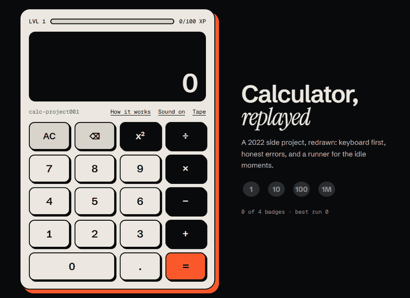

# Calculator, replayed · calc-project001

A small calculator that keeps score. Every result earns XP, results close together build a combo, and four badges wait to be found. Leave it alone for 15 seconds and the display turns into a one-button runner; press any calculator key and you are back in your sum, with that key applied.

**Live:** [yassinelakchouch.github.io/Calculator](https://yassinelakchouch.github.io/Calculator/) · **First version (2021):** [`/legacy/`](https://yassinelakchouch.github.io/Calculator/legacy/)



## Try

| Do | What happens |
| --- | --- |
| `7 × 8 =` | `56`, +1 XP |
| `0.1 + 0.2 =` | `0.3`, not `0.30000000000000004` |
| `8 ÷ 0 =` | "Can't divide by zero. Your number is kept." `⌫` takes the 0 back |
| Two results within 10 s | ×2 combo, up to ×5 |
| Wait 15 s | Unit appears; Space, ↑ or a tap on the screen jumps |
| Any key during the game | Back to the sum, key applied; Esc goes back with nothing typed |

Every case a visitor can try is listed, with its expected result, in [`docs/PLAN.md`](docs/PLAN.md), and each one is a test.

## Keyboard

`0–9` `.` `,` · `+` `-` `*` `x` `/` · `^` for x² · `Enter` or `=` · `Backspace` · `Esc` clears. In the game: Space or ↑ jumps.

## How it was built

1. **Measured the 2021 version first.** It used `eval()` for every result, had 50 × 35 px keys, and scrolled sideways on a phone.
2. **Designed it before coding it.** The study, the storyboard and every screen were drawn first; the loader, the opening scenes and the gain toast were designed the same way later.
3. **Rebuilt it in small pull requests**, engine first: the parser and its test cases, then rewards and the runner, then the page. 23 pull requests are merged; each merge to `main` redeploys the site.

## What I learned

- **Floating point is a display problem first.** Results are shown at 12 significant digits (`toPrecision(12)` in `src/engine/evaluate.ts`), so `0.1 + 0.2` reads `0.3` while the maths stays ordinary numbers.
- **A parser can be honest where `eval()` can't.** The shunting-yard engine knows why a sum failed, which is what lets the error say what happened and keep your number.
- **Examples miss what fuzzing finds.** A seeded test types 20,000 random key sequences and checks eight display rules after every key: no stacked squares, never `NaN`, a result within 16 characters, and so on. It caught `5²²` and a 20-character result that the hand-written cases had missed.

## What's next

- Runs earn nothing yet: the runner keeps a best score and one badge (Runner 100), but no XP.
- Difficulty is one rule: the speed goes up 5 % every 100 points. Obstacle patterns that change with the score would make longer runs worth it.

## Run

```sh
npm ci
npm run dev        # http://localhost:5180
npm test           # 113 unit tests: engine, rewards, runner, sound
npm run test:e2e   # 60 end-to-end tests on desktop and phone, in the installed Chrome
npm run build
```

## Stack

Vite 8 · TypeScript 7 (strict) · Tailwind CSS v4 (`@theme` tokens) · a shunting-yard parser · SVG and `requestAnimationFrame` for the runner · Web Audio for the clicks (each digit is a note of a pentatonic scale) · `localStorage` for XP, best run, badges and sound · Vitest and Playwright.

## Layout

```
src/engine   keys → expression → result (no eval), keyboard map
src/play     rewards, saved progress, the runner model, sounds
src/ui       sprites and the runner's scene
src/app.ts   wires keys, display, rewards, runner and sound together
e2e/         Playwright flows
public/legacy/  the 2021 version, served at /legacy/
docs/        the plan, and the demo above
```
